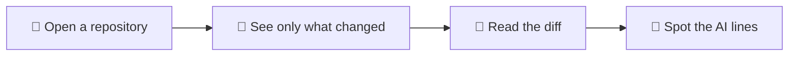

<div align="center">

# 🔍 augment-tool

### See what the AI wrote.

A desktop app for reviewing AI-assisted code changes.<br>
Every changed line, clearly marked as written by **AI** or by a **human**.


</div>

---

## 💡 Why it exists

AI agents now write a real share of our code, but reviews still treat every line the same.

When an agent opens a pull request, a reviewer has no quick way to tell **what the agent wrote**,
**what a person changed afterwards**, and **where to look hardest**.

**augment-tool answers that at a glance**, so you can spend your review time on the lines that need
it most.

## ✨ How it works



There's nothing to set up and no extra tracking. augment-tool reads the attribution git already
records: commit trailers such as `Co-Authored-By: Claude`, plus `git blame`.

#### What you'll see (illustration)

```diff
  function cartTotal(items) {
-   return items.reduce((a, b) => a + b);
+   return items.reduce((sum, item) => sum + item.price, 0);   // 🤖 AI
+   // Prices are already in pence, so no rounding needed      // 👤 Human
  }
```

## 🧭 What's coming

| Milestone            | What you get                                                                     | Status         |
| -------------------- | -------------------------------------------------------------------------------- | -------------- |
| **Foundations**      | App skeleton, guardrails and test fixtures                                       | 🚧 In progress |
| **Walking skeleton** | Open a repo, pick what to compare, browse only the changed files and their diffs | 🔜 Next        |
| **AI attribution**   | Every changed line marked AI, human or uncommitted, plus a per-file summary      | 🗓️ Planned     |
| **Extensibility**    | A sidebar of "functions", ready for AI review, suggestions and JIRA              | 🗓️ Planned     |
| **Release**          | Installers for Windows, macOS and Linux                                          | 🗓️ Planned     |

## 🛡️ Built to be trusted

- **🔒 Read-only:** it never changes your repository.
- **🧱 Safe on unknown code:** git runs through a small, locked-down bridge, with no shell access.
- **🧩 Extensible:** new capabilities plug in as sidebar functions.

## 🚀 Quick start

```sh
yarn install
yarn tauri dev
```

You'll need Node 18+ and Rust. The [development guide](docs/development.md) covers prerequisites,
scripts and how the code is organised.

---

<div align="center">
<sub>Built with Tauri, React and TypeScript · Reviewing AI code, with a little help from AI</sub>
</div>
